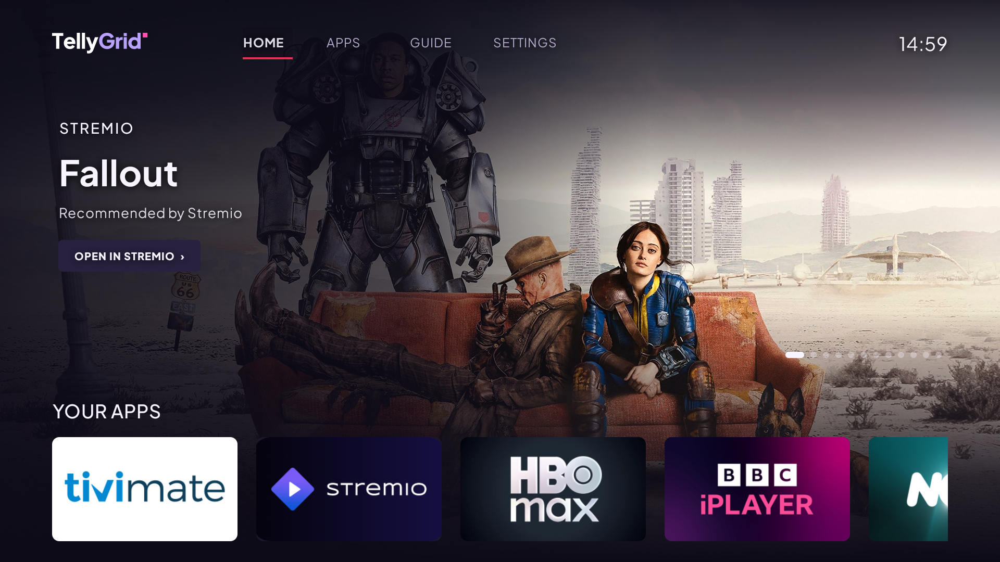
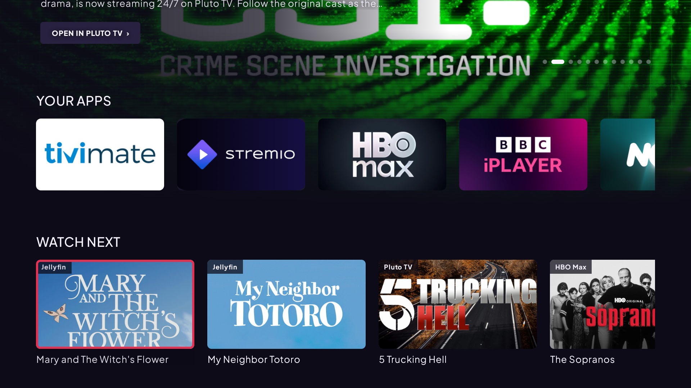
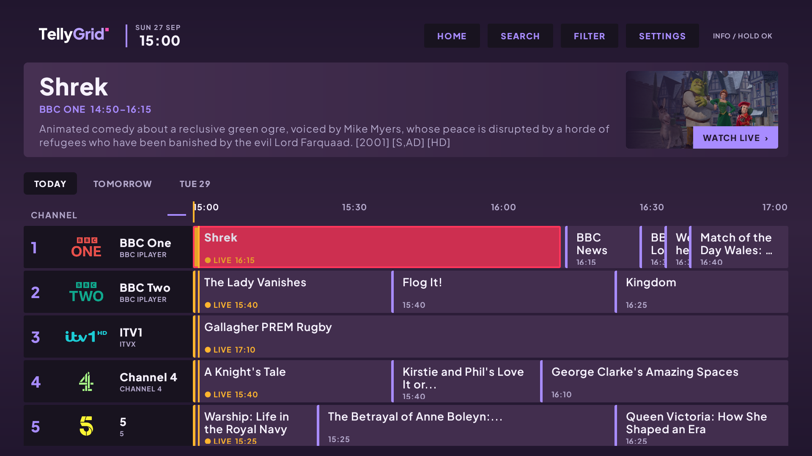
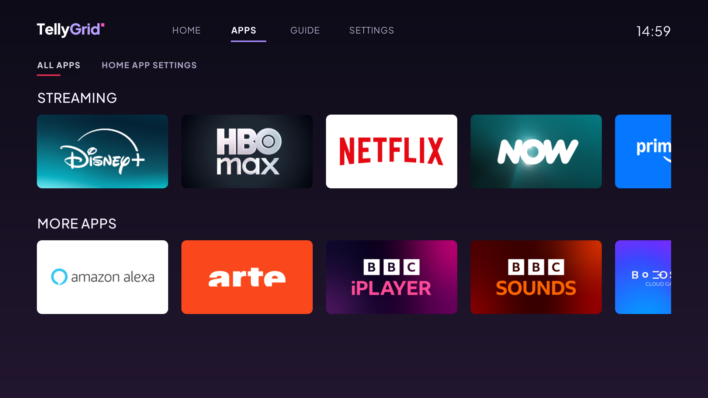
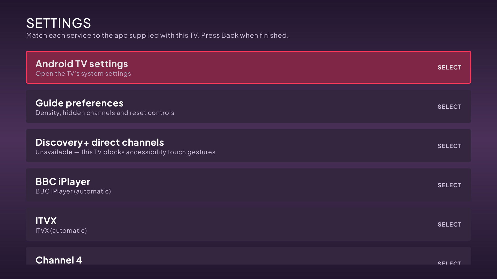

# TellyGrid

**A UK home screen for Android TV: recommendations from your apps, a live TV guide, and one click straight to the show.**

[](https://github.com/lozza/TellyGrid/actions/workflows/android.yml)
[](https://github.com/lozza/TellyGrid/actions/workflows/guide.yml)



| Home rows | Guide |
| --- | --- |
|  |  |
| **Apps** | **Settings** |
|  |  |

## Download

**[Get the latest APK from Releases](https://github.com/lozza/TellyGrid/releases/latest)** and sideload it onto your Android TV or Google TV.

This is an early test version, so far tested on a Philips Android 11 Freeview Play TV. Please report problems in [Issues](https://github.com/lozza/TellyGrid/issues).

## What it does

- **Home** shows a rotating banner and rows of recommendations published by your apps (Netflix, Disney+, Prime Video, Jellyfin, Stremio, Pluto TV and more), plus BBC iPlayer's most popular episodes. Picking one opens that exact title.
- **Watch next** lists what you were watching most recently, and you choose which apps can add to it.
- **Guide** is a time-grid guide for Freeview, NOW, discovery+, Pluto TV and TNT Sports channels. Selecting a channel opens it live, using the TV's tuner for Freeview.
- **Favourites** works like a Sky or Virgin record list. Hold OK on a show, or press Record, to save it. Guide favourites follow the series on any channel.
- **Apps** lists everything installed, updates itself when you add or remove an app, and lets you choose and order the apps on Home.
- **Updates** come straight from Settings → App updates, with no need to sideload each new version.

TellyGrid only hands off to apps you already have. It contains no streams, accounts or tokens.

## Setup

1. **Turn on the Home button override.** The first time you open TellyGrid, a setup screen asks you to switch on "TellyGrid Home button override" in Accessibility settings. This makes your remote's Home button open TellyGrid instead of the TV's built-in home screen. It only listens for the Home button and any remote buttons you set up in Settings → Remote buttons.
2. **Allow updates.** To use in-app updates, allow **Install unknown apps** for TellyGrid when Android asks (or in your TV's Security settings).

## What's new in alpha 8.1

Remote buttons: choose what a button on your remote opens (Home, Apps, TV Guide, Favourites or Settings), for example the Settings button opens the Guide. Full notes are on the [release page](https://github.com/lozza/TellyGrid/releases/tag/v0.8.1-alpha.8.1).

Alpha 8 added Favourites with a record button, in-app updates, a Home button that goes straight to TellyGrid without the stock launcher flashing, a guided setup screen, and an Apps list that refreshes when you install something.

## Build it yourself

Needs JDK 17 and Android SDK 35:

```bash
./gradlew test assembleDebug
adb install -r app/build/outputs/apk/debug/app-debug.apk
```

## More detail

- [Technical notes](docs/TECHNICAL.md): architecture, provider links, the guide feed and the roadmap.
- [Handoff notes](docs/HANDOFF-2026-09-27.md): current state and what to do next.
